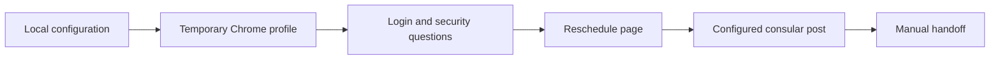

<div align="center">

# VisaPilot

**Your configuration. One browser session. You take it from there.**

A configurable Playwright starter for a user-assisted visa scheduling workflow.

**English · [简体中文](README.zh-CN.md)**

[](https://nodejs.org/) [](package.json) [](package.json) [](#limitations) [](https://github.com/Elyon0517/VisaPilot/stargazers)

**Find this useful? [Give it a star ⭐](https://github.com/Elyon0517/VisaPilot/stargazers)**

[Quick start](#quick-start) · [Configuration](#configuration) · [Usage](#usage) · [Scheduling](#optional-macos-scheduling) · [Privacy](#privacy) · [Contributing](#contributing)

</div>



## What it does

- Opens the public usvisascheduling.com homepage in a temporary Chrome profile.
- Makes one login attempt using credentials supplied locally.
- Fills configured security-answer fields, waits through virtual queues, and lets you complete human verification manually.
- Opens the Reschedule Appointment page and selects the exact consular-post label you configure.
- Optionally waits for the next half hour, with navigation to keep the session active.
- Stops before selecting applicants, submitting an appointment, or confirming a booking.

This is an independent community project, unaffiliated with any government or appointment provider. Page selectors can change. Use only where permitted by the site's rules and your account limits. Human verification stays manual; there is no CAPTCHA bypass. Availability monitoring, notifications, and automatic booking are not implemented.

## Quick start

Install Node.js 20+ and Google Chrome, then run:

```sh
git clone https://github.com/Elyon0517/VisaPilot.git
cd VisaPilot
npm ci
cp .env.example .env
```

## Configuration

Edit `.env` locally:

| Variable | Purpose | Default |
| --- | --- | --- |
| `VISA_EMAIL` | Your login identifier | Empty |
| `VISA_PASSWORD` | Your password | Empty |
| `VISA_SECURITY_ANSWERS` | JSON object mapping your account's input IDs to answers | `{}` |
| `VISA_CONSULAR_POST` | Exact visible option label for the desired post | Empty |
| `HEADLESS` | Run without a visible window | `false` |
| `ALIGN` | Wait for the next `:00` or `:30`, in the machine's timezone | `false` |
| `KEEP_OPEN` | Leave the browser open for manual use | `true` |
| `SAVE_SCREENSHOTS` | Save local diagnostic screenshots | `false` |

Security field IDs depend on your account. Inspect them locally; no personal questions or answers are included. For example, the JSON format is `VISA_SECURITY_ANSWERS='{"your_field_id":"your_local_answer"}'`. Configure every answer field your account may display. Unknown or unconfigured fields stop the flow before submission.

## Usage

```sh
npm run open       # Open the homepage for manual exploration
npm run login      # Run the configured flow once
npm run check      # Check JavaScript syntax without visiting the site
node src/inspect.js # Inspect public-page field metadata; does not log input values
```

Close the browser window to end a manual login run. Each run uses a temporary profile and attempts to delete it when the browser closes. Forced termination or machine failure can leave temporary files behind.

## Optional macOS scheduling

`run-once.sh` wraps one run with a wall-clock watchdog (25 minutes by default) and writes daily logs into `logs/`. It uses `node` from `PATH`, or the absolute executable supplied by `NODE_BIN`.

```sh
./run-once.sh
MAX_MINUTES=15 ./run-once.sh
```

For launchd, copy `examples/com.example.visa-auto.plist` to `~/Library/LaunchAgents/`, replace **every** `/ABSOLUTE/PATH/TO/visa-auto` with your checkout's absolute path, and adjust the example schedule and `PATH` for your machine. Create the checkout's `logs` directory first. The template uses the machine's local timezone. Choose a directory macOS allows background processes to access.

```sh
mkdir -p logs "$HOME/Library/LaunchAgents"
# After editing and copying the template:
launchctl bootstrap "gui/$(id -u)" "$HOME/Library/LaunchAgents/com.example.visa-auto.plist"
# Stop the scheduled agent:
launchctl bootout "gui/$(id -u)/com.example.visa-auto"
```

The template runs once daily at noon as an example. Scheduling requires the machine to be awake. The watchdog ends long-running sessions so later runs can start; manual `npm run login` runs have no watchdog.

## Privacy

Real credentials, answers, browser sessions, logs, and screenshots are not distributed with this project. Keep `.env` local. Runtime output and `.env` files are ignored by Git, and screenshots are disabled by default. If you enable screenshots or share diagnostic logs, review them first: authenticated pages and error details may contain personal information. Never attach account data to an Issue or PR.

## Project structure

```text
src/browser.js    Temporary browser profiles, queue waiting, optional screenshots
src/flow.js       Login, configurable answer mapping, navigation and post selection
src/login.js      Single-run workflow
src/open.js       Manual browser entry point
src/inspect.js    Field metadata inspection
run-once.sh       macOS shell wrapper with watchdog
examples/         Generic launchd template
.env.example      Empty local configuration template
```

## Limitations

Experimental software: selectors and account-specific security fields may change. Browser behavior has to be verified with your own authorized account. There is no availability monitoring, notification service, or automatic booking. Human verification requires manual interaction. The optional scheduling wrapper targets macOS.

## Contributing

Bug reports, documentation improvements, and small focused pull requests are welcome. Describe expected and actual behavior, include your Node.js/macOS versions where relevant, and remove all personal data from examples. Run `npm run check` and `zsh -n run-once.sh` before submitting. Test browser behavior with your own authorized account; never add credentials or recorded sessions to tests.

---

<div align="center">

If this project helps you, please consider [giving it a star ⭐](https://github.com/Elyon0517/VisaPilot/stargazers).

</div>
